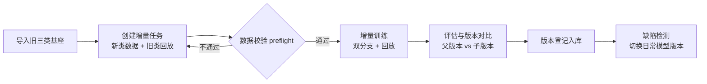

# 钢材表面缺陷类增量学习系统 V1.0

<p align="center">
  
  
  
  
  
  
</p>

> 基于双分支 Deformable DETR 的钢材表面缺陷**类增量目标检测**系统：在不重训基座模型的前提下，增量学习新缺陷类别，并通过旧类回放抑制灾难性遗忘，全程提供可视化 Web 界面。

---

## 项目简介

传统检测模型一旦训练完成，新增缺陷类别就需要全量重训，成本高且旧数据往往已不可得。本系统面向工业质检场景，实现了**一次 3+3 类别增量**的完整闭环：

- 在兼容的旧三类（3 类）基座检测器上，仅用新增类别的少量标注数据 + 旧类回放样本，增量扩展为六类检测器；
- 训练前后自动评估、父子版本对比，模型版本登记入库、可随时切换用于日常检测；
- 基于 Gradio 的五页交互界面，从数据校验到版本管理全流程可视化。

检测类别来自 [NEU-DET](http://faculty.neu.edu.cn/songkechen/zh_CN/zdylm/263270/list/) 钢材表面缺陷数据集的六类：

| 中文类别 | 英文标签 | | 中文类别 | 英文标签 |
|---|---|---|---|---|
| 裂纹 | `crazing` | | 点蚀表面 | `pitted_surface` |
| 夹杂物 | `inclusion` | | 氧化铁皮压入 | `rolled-in_scale` |
| 斑块 | `patches` | | 划痕 | `scratches` |

## 核心特性

- **类增量训练**：旧三类基座 + 新三类标注数据，回放缓冲（Replay）抑制遗忘，支持单阶段 3+3 增量；
- **双分支检测头**：在 Deformable DETR 基础上引入双分支结构与增量适配器（Incremental Adapters），旧类知识与新类学习解耦；
- **严格版本管理**：父/子版本登记、最佳权重严格重载校验、同图前后对比评估、版本持久化（SQLite）；
- **数据安全校验**：上传前预检（preflight），类别编号局部映射、训练/验证集像素哈希不交叉检查，不合格数据直接拦截；
- **开箱即用的演示包**：附旧三类基座、日常六类 dual 最佳模型与 60 张示例图片，无需下载外部权重即可跑通全流程；
- **真实训练管线**：演示配置之外可接入完整数据集与自定义样本额度/轮数，训练曲线实时可视。

## 系统流程



界面按五个页面组织操作路径：**项目与基座 → 创建增量任务 → 训练监控 → 评估与版本 → 缺陷检测**。

## 快速开始

### 环境要求

| 组件 | 版本 |
|---|---|
| 操作系统 | Windows（已在 Win10/11 验证） |
| Python | 3.12.x |
| PyTorch | 2.5.1 + cu121（torchvision 0.20.1 + cu121） |
| 界面框架 | Gradio 4.44.1 |

> 随仓库提供的 CUDA 扩展（`models/ops/*.pyd`）仅适用于 Windows + CPython 3.12 + PyTorch 2.5.1 组合；其他环境可使用内置的 PyTorch 纯 Python 回退路径，或在 `models/ops/` 下重新编译。

### 安装与启动

```bash
# 1. 先安装与本机 CUDA 匹配的 torch / torchvision（略）
# 2. 安装依赖
pip install -r 02_软件源码/requirements.txt

# 3. 启动系统（自动在 7860–7880 选择空闲端口并打开浏览器）
cd 02_软件源码
python -B launch.py
```

Windows 下也可直接双击 `02_软件源码/启动系统.bat`；若默认 Python 不是训练环境，可指定路径：

```powershell
powershell -ExecutionPolicy Bypass -File .\启动系统.ps1 -Python '实际训练环境的python.exe路径'
```

> **注意**：本仓库因体积限制未包含 `.pth` 模型权重（见 `.gitignore`）。权重文件随桌面发行包提供：`MODEL/base_output_group1/checkpoint_phase0.pth`（旧三类基座）与 `MODEL/daily_dual/best_overall_phase1.pth`（日常六类 dual 模型）。无权重时界面仍可启动，但检测与训练功能需先导入基座。

### 演示增量训练（5 分钟跑通）

1. 打开界面，在「项目与基座」导入旧三类基座权重；
2. 「创建增量任务」上传新类数据 ZIP（每类 5 张即可演示）+ 旧类回放包；
3. 「训练监控」实时查看进度与曲线（演示默认每新类 5 张、每旧类回放 5 张、1 轮、batch=2）；
4. 「评估与版本」对比父子版本 AP，登记新版本；
5. 「缺陷检测」上传图片（如 `scratches_1.jpg`）获取检测框与结果表。

任务记录与模型版本持久化于 `02_软件源码/app_runs/workflow/`（SQLite），刷新页面不丢失。

## 方法概要

```
输入图像
   │
   ├─ ResNet Backbone ──→ 多尺度特征
   │                          │
   │              Deformable Transformer 编码-解码
   │                          │
   ├─ 旧类分支（冻结知识 + 回放监督）
   ├─ 新类分支（增量适配器适配新类别）
   │
   └──→ 双分支去噪训练（Dual Denoising）──→ 六类检测结果
```

- **基座兼容性**：增量训练直接从完整存档恢复 backbone，不重复下载 torchvision 初始化权重；
- **回放机制**：为每个旧类保留少量样本参与训练，缓解新类学习对旧类的干扰；
- **评估闭环**：训练前基线评估 + 训练后重评估 + 同一验证集的父子版本对比，旧类/新类/整体 AP 分曲线呈现。

## 仓库结构

```
.
├── 00_先读我.md               # 快速导读
├── 02_软件源码/               # 可独立运行的精简工程（核心代码）
│   ├── launch.py              # 应用入口（端口自动选择）
│   ├── app.py                 # Gradio 五页界面
│   ├── incremental_train.py   # 类增量训练主流程
│   ├── dual_branch_train.py   # 双分支训练逻辑
│   ├── models/                # 双分支 Deformable DETR 模型与 CUDA 算子
│   ├── adapters/              # 基座模型适配器
│   ├── datasets/              # NEU-DET / COCO 数据集接口与数据增强
│   ├── services/              # 任务、数据集、版本登记服务
│   ├── ui/                    # 工作流页面逻辑
│   ├── util/                  # 检测指标、checkpoint 管理等工具
│   ├── NEU-DET/               # 60 张示例图片与标注（六类各 5 张训练 + 5 张验证）
│   └── configs/               # 推理与训练默认配置
├── 03_运行说明/               # 环境安装、资源清单与打包验证报告
└── 软件信息.json               # 软件元信息
```

## 适用范围与限制

当前版本针对**本项目兼容的旧三类基座**实现了一次 3+3 类别增量，以下能力暂未实现：

- 任意模型家族自动适配（其他家族需开发对应适配器）
- 任意类别数量的连续多阶段增量
- 界面内基座初训、训练中断续训

演示数据（每类 5 张、1 轮）仅用于流程验证，**不代表正式训练精度**；正式使用请接入足量、独立且来源清晰的数据。

## 许可证与致谢

- 本项目代码基于 [Deformable DETR](https://github.com/fundamentalvision/Deformable-DETR)（Apache License 2.0, Copyright (c) 2020 SenseTime）修改扩展，许可证见 [02_软件源码/LICENSE](02_软件源码/LICENSE)，第三方组件声明见 [02_软件源码/THIRD_PARTY_NOTICES.md](02_软件源码/THIRD_PARTY_NOTICES.md)；
- 示例数据来自东北大学 [NEU-DET 钢材表面缺陷数据集](http://faculty.neu.edu.cn/songkechen/zh_CN/zdylm/263270/list/)，仅用于流程演示；
- 感谢 Gradio、PyTorch 等开源社区的支持。

---

<p align="center">如果这个项目对你有帮助，欢迎点一个 Star</p>
